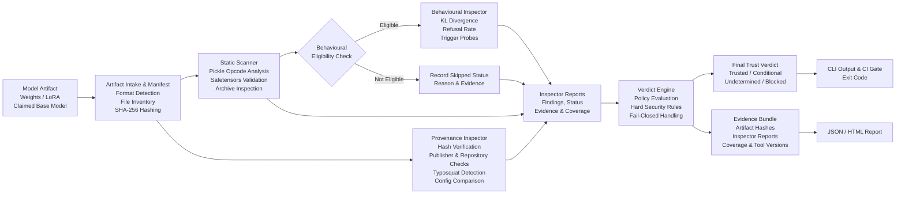

# ai-supply-chain-security architecture

One artifact enters ai-supply-chain-security, three inspectors analyse it independently, and only the verdict engine classifies it. The result is a trust verdict and an evidence bundle. Version 1 is Option A from [architecture-options.md](architecture-options.md): one host process, with the behavioural stage in Docker, and JSON contracts that can move an inspector into its own container later (Option B). The written design is [hld.md](hld.md). This page restates that design and then records the verdict order the code actually uses, which is not the order in the HLD. The problem is in [problem-statement.md](problem-statement.md). The tree on disk is in [implementation-solution.md](implementation-solution.md).

## Principle

> One artifact enters ai-supply-chain-security → three independent inspectors analyse it → a central verdict engine evaluates their reports → ai-supply-chain-security produces a trust decision and an evidence bundle.

That is a logical split. It is not a requirement for three operating-system processes. The brief requires the three inspectors and a central verdict. Putting them in one process, and isolating only the behavioural stage, is the Option A proposal that the HLD adopts.

## Diagram

The HLD also has a PNG. This page does not depend on it. The diagram below is the mermaid source from [hld.md](hld.md).

Intake is on the path because inspectors need a file inventory and hashes before they can report. The behavioural stage is gated: a file the static scanner has already called critical is not loaded.

## Components

| Component | Responsibility | Where it runs |
| --- | --- | --- |
| Model artifact | Model weights, a LoRA adapter, and the claimed base model | Input |
| Artifact intake and manifest | Every file, including files nested in archives: format, size, SHA-256 | Host |
| Static scanner | Pickle opcodes, Safetensors headers, archives, without executing untrusted code | Host module |
| Provenance inspector | Hashes, publisher information, repository-name similarity, model configuration | Host module |
| Behavioural eligibility check | Whether behavioural testing can safely proceed | Host |
| Behavioural inspector | Compare candidate behaviour with the base model and probe for backdoors | Docker container |
| Inspector reports | Findings, check statuses, and coverage in one shared format | Shared contract |
| Verdict engine | Apply policy and decide the trust status | Host |
| Evidence bundle | Findings, hashes, reports, and execution metadata | Output |
| CLI and CI gate | Show the verdict and return the exit code | Output |

Shared contracts, as proposed in the HLD, are `ScanRequest`, `ArtifactManifest`, `CheckResult` (passed, failed, error, skipped, not applicable), `Finding` (info, warning, critical), `InspectorReport`, `Verdict`, and `EvidenceBundle`. Inspectors emit a check id and the evidence. Default severity per check id lives in the YAML policy. That split is a proposal so that changing what counts as critical does not require changing inspector code. The brief requires the inspectors to be independent and the verdict to be evidence-backed. It does not specify these model names.

## Five execution rules

These five rules are the HLD’s execution policy. Rules 1 and 5 restate the brief (independent inspectors, one classifier). Rules 2, 3, and 4 turn the brief’s “do not blindly load” and “fail closed” principles into a concrete procedure. The container flags in rule 3 are a proposal.

1. **Independent inspection.** Static and provenance inspection do not read each other’s output. They may run in parallel. Version 1 runs them in one process, one after the other. Independence here means separate modules and separate reports.
2. **Behavioural eligibility.** The behavioural inspector does not load a model when the static scanner reported a critical finding. The full conditions are below.
3. **Docker isolation.** The behavioural inspector runs in a container with networking disabled, the artifact mounted read-only, CPU and memory limits, a wall-clock timeout, safe loading only (Safetensors, or `torch.load` with `weights_only=True`), a read-only root filesystem, a non-root user, and one writable scratch directory.
4. **Fail closed.** A required check that fails, crashes, times out, or is skipped is never treated as passed.
5. **Only the verdict engine classifies.** Inspectors report evidence. They do not declare an artifact Trusted.

## Verdict order as implemented

The brief requires hard rules, fail closed, and the four verdict names. It does not specify which rule wins when a warning and a missing proof of trust are both present. The HLD proposes an order. The code uses a different order. Both are design choices. The code’s order is the one a scan follows.

The written HLD evaluates insufficient evidence before warnings. The code evaluates warnings first. A spoofed base with no hash anchor is Conditional, not Undetermined. The corpus fixture `spoofed-base` is that case: the adapter names a different base, the hash check does not anchor the file, and the scan exits 10. Under the HLD’s written order, the missing anchor would have decided Undetermined before the warning was considered. Recorded exits are in [implementation-solution.md](implementation-solution.md).

Implemented order, first match wins:

| Order | Condition | Verdict | Exit |
| --- | --- | --- | --- |
| 1 | Any critical finding | Blocked | 30 |
| 2 | A required check whose status is error | Undetermined | 20 |
| 3 | Any warning | Conditional | 10 |
| 4 | No provenance hash anchor, or no behavioural coverage | Undetermined | 20 |
| 5 | Otherwise | Trusted | 0 |

Exit 2 is a usage error before a scan. The scan does not run, and there is no verdict. The number is the same proposal as the other codes: the brief requires a non-success exit for a bad invocation and does not assign the integer.

Two further differences from the written HLD, both visible in the code:

* Rule 2 matches status `error` on a required check. A skip whose reason is a coverage gap (no known-good reference, offline, no attestation, publisher not claimed, adapter with no model config) is not that error. The skip still cannot become Trusted: with no warning, rule 4 catches a missing anchor or missing behavioural coverage.
* The v1 provenance anchor is a passed `provenance_hash_match`. The HLD also accepts a verified signature. The code records signature files and does not verify them, so a signature alone is not an anchor.

Trusted on a live scan requires a passed hash anchor and a completed behavioural run (`behavioural_coverage` passed, and `behavioural_marker` not failed), with no warning left. A skipped or errored behavioural report is not coverage. Trusted is unreachable on a live scan until the behavioural container actually runs.

## Behavioural eligibility

The stage runs only when every condition below holds. Otherwise the orchestrator records a skip and a reason. The host check does not open weight files. “Eligible” means the scan may try the container. It does not mean the artifact can generate text.

The HLD’s eligibility list and the code agree on the safety idea: no critical static finding, static inspection finished, a safe load path, a verified base present locally, and a model inside the resource profile (the brief’s about 0.1B–0.5B parameters). The code’s safe-load test is narrower than the HLD sentence: every weight file must already be Safetensors. The HLD also allows a pickle that passes a `weights_only` allowlist. That allowlist is not what the host eligibility check uses.

| Order | Must be true | Skip reason in the code |
| --- | --- | --- |
| 1 | Static report has no critical finding | `static_critical` |
| 2 | Static report has no check in status error | `static_incomplete` |
| 3 | Every weight file is Safetensors | `no_safe_load_path` |
| 4 | The claimed base is in the local registry and that row has a root hash | `base_unverified` |
| 5 | A local base directory is available (registry path or the scan’s base directory) | `base_weights_missing` |
| 6 | Estimated parameter count, when intake recorded one, is within the policy limit | `exceeds_resource_profile` |

The strict policy limit is 500,000,000 parameters, which matches the top of the brief’s range. Putting the number in YAML is a proposal.

## Version 1 is Option A

[architecture-options.md](architecture-options.md) compares three shapes. Option A is one Python process: intake, static, provenance, and the verdict engine in-process; only behavioural execution in Docker. Option B runs every inspector in its own container. Option C is a long-running scan service. The options note recommends starting at A so that B is packaging work later. The HLD adopts that path.

Version 1 is Option A. Inspectors talk through a request in and a report out, serialised as JSON. Moving static or provenance into a container later is Option B, and it does not require a new verdict model. Option C’s shared registry is, for v1, a local YAML file. That deployment choice is a proposal. The brief asks for a CLI and a CI gate, and it does not ask for a service.

## Where to read next

* [hld.md](hld.md) — the full HLD, including the research notes and the original rule order.
* [architecture-options.md](architecture-options.md) — Options A, B, and C, and why A was the starting point.
* [problem-statement.md](problem-statement.md) — scope, deliverables, and what the brief does not decide.
* [implementation-solution.md](implementation-solution.md) — commands, packages, corpus exits, and what this environment cannot run.
